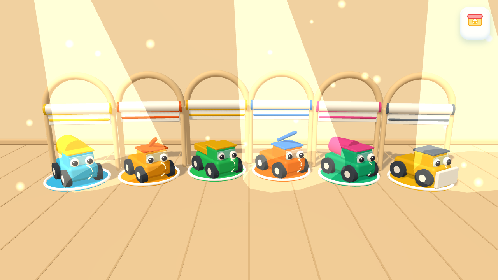
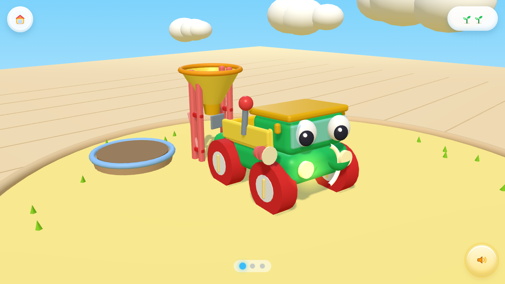
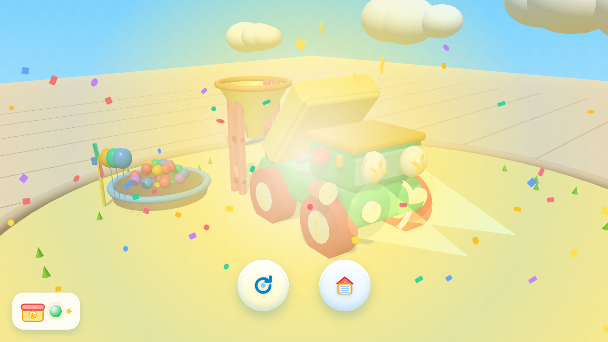
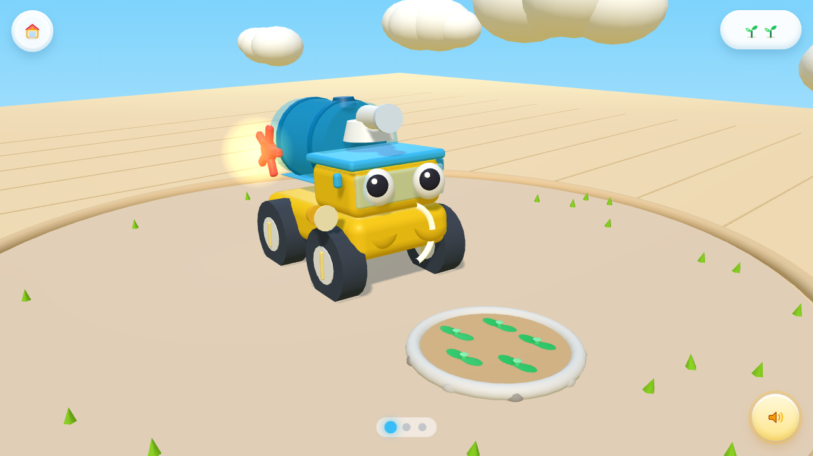

# 萌宝工程车：英语互动乐园（Little Builders: Talk & Play）

面向 **2-3 岁幼儿**的纯用户端、**100% 纯离线** TPR（Total Physical Response）英语互动应用。
六辆萌系工程车 → 六个连贯场景 → 每条主线 3 步「听指令 → 做操作 → 看级联反馈 → 听英语强化」。

- **无网络依赖**：无 CDN、无在线字体/图标/模型、无云端 TTS。飞行模式下可完整运行。
- **无文字 UI**：全界面零字母、零数字、零单词。等级切换只用 1/2/3 株幼苗图形。
- **无家长中心**：无登录、无家长锁、无防沉迷计时、无统计报表。启动即进车库。
- **幼儿容错**：1.45 倍热区、屏幕向量投影拖拽、30% 自动磁吸、<400ms 单点兜底、三指拍击必成、1.5s 长按返回防误触。

技术栈：`React 18 + TypeScript + Three.js + Vite 5 + Capacitor 6`（iOS / Android 本地封装）。

---

## 一、本地运行

```bash
npm install                      # 依赖（CI/网络受限可用 --registry=https://registry.npmmirror.com）
npm run dev                      # http://localhost:5173
npm run build                    # 类型检查 + 产出 dist/
npm run preview                  # 预览生产构建
```

> 首次点击/触摸会解锁 WebAudio（iOS 要求用户手势）。

## 二、目录结构（实际落盘）

```
little-builders-offline-app/
├── capacitor.config.ts                 # 跨平台配置：无 server.url，纯本地资源
├── index.html                          # 全屏 viewport，禁止缩放
├── scripts/
│   ├── buildOfflineVoices.mjs          # 构建期离线语音清单 + m4a 烘焙
│   └── patchNative.mjs                 # iOS/Android 强制横屏 + 沉浸式全屏补丁
├── public/audio/
│   ├── manifest.json                   # 自动生成：全部 clipId ↔ 台本
│   ├── L1/ L2/ L3/                     # 离线语音包（m4a/mp3，可空）
├── src/
│   ├── main.tsx                        # 入口 + 全局防误触（右键/双指/双击）
│   ├── App.tsx                         # GARAGE_LOBBY ↔ VEHICLE_SANDBOX 路由
│   ├── config/vehiclesConfig.ts        # 6 车全量配置（126 条语音台本 / 14 主线部件）
│   ├── engine/
│   │   ├── AudioEngine.ts              # 三路增益混音 + 18 种程序化音效 + 离线 TTS 三级兜底
│   │   ├── audio.ts                    # 全局单例 + 首次手势解锁
│   │   ├── ToddlerInputManager.ts      # 热区膨胀 / 向量投影拖拽 / 吸附 / 拍击过滤
│   │   ├── ScenarioStateMachine.ts     # IDLE→PROMPT→ACTING→CASCADE_FEEDBACK→REWARD
│   │   └── toyKit.ts                   # 软胶材质 / 圆角几何 / 程序化贴图 / 缓动
│   └── components/
│       ├── garage/SunshineGarage3D.tsx # 阳光车库：6 拱形车位 + 卷帘门 + 发车过渡
│       ├── sandbox/
│       │   ├── SandboxCanvas3D.tsx     # 2.5D 锁定相机 / 光照 / 渲染循环 / 射线输入
│       │   ├── VehicleRigBuilder.tsx   # 参数化车辆组装 + 4 种生命状态
│       │   ├── rigCommon.ts            # 底盘 / 车轮履带 / 大眼睛控制器
│       │   ├── rigKits.ts              # 六车专属可动部件（水炮/机械臂/车斗/吊臂/搅拌罐/推铲）
│       │   ├── EnvironmentCascade.tsx  # 六个场景的连续级联反馈
│       │   └── GuideHandOverlay3D.tsx  # 3D 投影引导小手
│       └── ui/
│           ├── ZeroTextHUD.tsx         # 1.5s 长按返回 / 幼苗等级 / 重播 / 进度点
│           ├── StickerCelebration.tsx  # 纸屑 + 贴纸飞入贴纸盒 + 果冻按钮
│           └── icons.tsx               # 纯图形 SVG 图标库
└── src/styles/                         # global / scene / hud / celebration
```

## 三、离线保证清单

| 项 | 实现方式 |
| --- | --- |
| 3D 模型 | 全部 `RoundedBoxGeometry` / `CylinderGeometry` 等参数化程序建模，零 glTF 下载 |
| 材质贴图 | 糖果螺旋条纹、径向光晕均由 `CanvasTexture` 运行时生成 |
| 音效 | Web Audio 振荡器 + 滤波白噪声实时合成 18 种 Sfx |
| 背景乐 | 程序化五声音阶木琴，`setInterval` 逐音合成 |
| 英语人声 | ①`public/audio/{L1,L2,L3}/{clipId}.m4a|mp3` → ②原生 TTS → ③WebView `speechSynthesis` |
| 字体/图标 | 系统字体 + 内联 SVG，无任何网络字体 |
| 数据 | `localStorage` 存贴纸与等级 |

## 四、双端打包

```bash
# 1) 生成离线语音包（可选，不生成则自动用系统 TTS）
npm run voices:generate

# 2) iOS
npm run cap:add:ios          # build + cap add ios + 横屏补丁
npm run cap:open:ios         # Xcode 中签名运行（Bundle ID: com.littlebuilders.talkandplay）

# 3) Android
npm run cap:add:android
npm run cap:open:android

# 每次改完 Web 代码
npm run cap:sync
```

`patchNative.mjs` 会自动完成：

- iOS `Info.plist`：仅 `LandscapeLeft / LandscapeRight`、`UIRequiresFullScreen`、`UIStatusBarHidden`
- Android `AndroidManifest.xml`：`android:screenOrientation="sensorLandscape"` + `configChanges`
- Android `MainActivity`：`BEHAVIOR_SHOW_TRANSIENT_BARS_BY_SWIPE` 沉浸式全屏

> 原生编译与提审必须在装有 Xcode / Android SDK 的机器执行；本仓库产出的是可直接被 Capacitor 消费的 Web 工程。

## 五、关键参数（与 PRD 对齐）

| 参数 | 值 | 位置 |
| --- | --- | --- |
| 热区膨胀 `k_hit` | 1.45 | `ToddlerInputManager.HIT_EXPANSION` |
| 满行程拖拽 `L_max` | 150 px | `DRAG_FULL_PX` |
| 自动磁吸阈值 | 0.30 | `SNAP_THRESHOLD` |
| 吸附速率 `v_snap` | 2.5 s⁻¹ | `ScenarioStateMachine.SNAP_RATE` |
| 点击兜底 | <400ms 且位移 <30px | `TAP_MAX_MS` / `TAP_MAX_MOVE_PX` |
| 手掌拍击 | ≥3 指直接完成 | `PALM_TOUCH_COUNT` |
| 长按返回 | 1.5 s 环形蓄满 | `ZeroTextHUD.HOLD_MS` |
| 空闲重播 | 5.0 s | `IDLE_REPROMPT_MS` |
| 相机 | FOV 38° / 俯角 18° / 偏航 +45° | `SandboxCanvas3D.CAM_*` |
| 混音 | SFX -3→-18 dB、BGM -14→-26 dB | `AudioEngine.engageDucking()` |
| TTS 儿向语 | rate 0.88 / pitch 1.18 | `speakEnglish()` |
| 呼吸 | y = y₀ + 0.025·sin(3.5t) | `VehicleRigBuilder.update` |

## 六、已知取舍

1. **相机偏航由 -25° 调整为 +45°**：PRD 的 -25° 会让机位落在车辆左后方，前挡风玻璃上的双眼被车身完全遮挡，"拟人化大眼睛"这一核心生命系统无法呈现。改为右前方 45° 后，车头正脸（双眼）与右侧场景道具同时可见，且"向右滑动"的手势方向与车头朝向一致。俯角 18°、FOV 38°、禁止自由旋转均保持原规范。
2. **自卸车卸料方向**：车头统一朝 +X（屏幕右侧），自卸车车斗铰接在车尾，因此沙池位于画面左侧（车辆正后方），符合真实自卸逻辑；PRD 文字描述的"右侧沙坑"以机械合理性优先。
3. **每辆车主线第 2/3 步共用同一部件**（如挖掘机 `part_bucket_arm`、吊车 `part_crane_boom`），通过 `stepIndex` 分支给出「下压/抬升」「伸长/安装」两段不同的关节轨迹。
4. **车库车辆为简化预览模型**（约 40 个 mesh/辆，复用同一套 4 状态眼睛控制器），避免 6 辆全量 rig 同屏导致移动端掉帧。
5. **1.45 倍热区必然造成相邻部件互相覆盖**，因此射线检测采用「目标部件优先」策略：射线落在当前引导目标的膨胀区内即判定命中，其余部件才按距离取最近，保证幼儿不会因为热区重叠卡关。
6. **未在本机执行 Xcode / Gradle 编译**：本环境无 iOS/Android SDK，`dist/` 已可直接被 Capacitor 打包。

## 七、渲染验收（无头 Chrome + SwiftShader 实拍）

| 车库大厅 | 工地沙盘 |
| --- | --- |
|  |  |

| 过关庆典 | 洒水车场景 |
| --- | --- |
|  |  |

六车逐一巡检脚本：`node scripts/audit.mjs`（逐辆进工地 → 映射目标部件屏幕坐标 → 真实指针拖拽 → 断言状态机推进）。

| 脚本 | 用途 |
| --- | --- |
| `scripts/buildOfflineVoices.mjs` | 离线语音清单 / m4a 烘焙 |
| `scripts/patchNative.mjs` | iOS·Android 横屏与沉浸式补丁 |
| `scripts/audit.mjs` | 六车全量巡检 + 截图 |
| `scripts/final.mjs` | 三步通关 + 庆典层断言 |
| `scripts/probe.mjs` | 状态机阶段/进度探针 |

## 八、验收自检

- [x] 六车全量配置与台本落盘（252 条离线语音片段按 L1/L2/L3 归类）
- [x] 三路增益 + 语音闪避时序（50ms 压低 / 200ms 恢复）
- [x] 18 种 SfxType 全枚举程序化合成
- [x] 拖拽投影 / 30% 吸附 / 点击兜底 / 三指拍击
- [x] 5s 空闲重播 + 半透明小手示范
- [x] 长按 1.5s 环形返回
- [x] 幼苗 1/2/3 株切换器（零文字）
- [x] 眼睛 4 状态（呼吸/倾听/用力/星星）+ 车身跳跃
- [x] 六场景级联反馈（开花 / 挖宝 / 填坑 / 树屋 / 星路 / 通障）
- [x] 贴纸 + 儿歌庆典 + localStorage 持久化
- [x] 横屏原生补丁脚本 + 离线语音烘焙脚本
